::: {.hero-container}

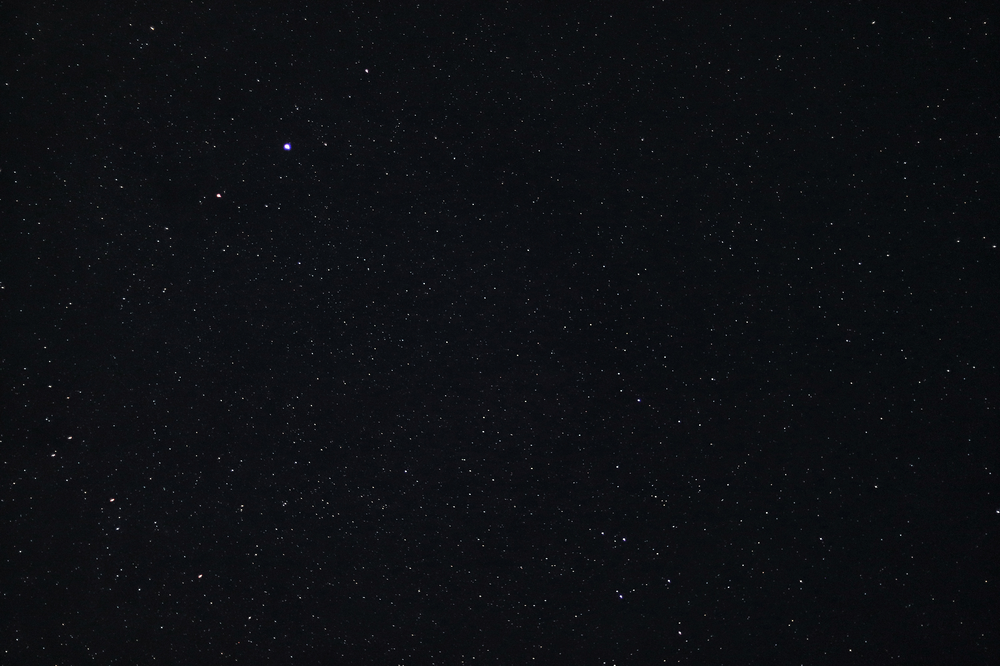{.hero-image}

::: {.hero-text}
# Welcome to Abhi's Space

Exploring the natural world, one story at a time.
:::

:::

## Hi, I'm Abhi!

I'm a nature photographer, wildlife enthusiast, birdwatcher and writer.

I love photography, ecology, birds, music and running. This website is where I share my photography, essays, field notes, projects and other things that interest me.

It's a little corner of the internet where I document what I discover, what I create and what I learn along the way.

## Explore

A collection of things I observe, create and work on.

::: {.explore-grid}

::: {.explore-card}
01

### Photography

Wildlife, landscapes, birds and moments worth remembering.

[Explore photography →](photography.qmd)
:::

::: {.explore-card}
02

### Ecology & Projects

Field research, conservation, restoration and ongoing experiments.

[Explore projects →](projects.qmd)
:::

::: {.explore-card}
03

### Writing & Essays

Thoughts, observations, stories and occasional ramblings.

[Read my writing →](essays.qmd)
:::

::: {.explore-card}
04

### Nature Education

Learning resources, field guides and things I've learnt along the way.

[Explore resources →](nature-education-index.qmd)
:::

:::

## Through the Lens

Some moments from the natural world.

::: {.photo-grid}

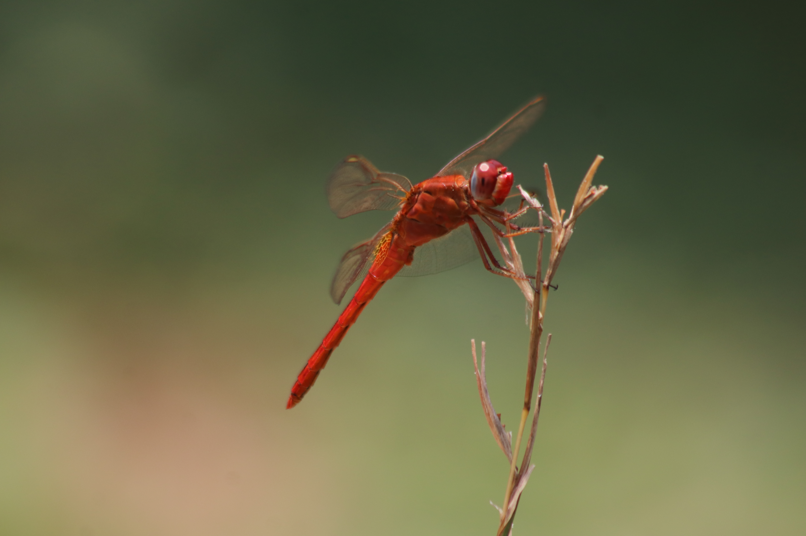

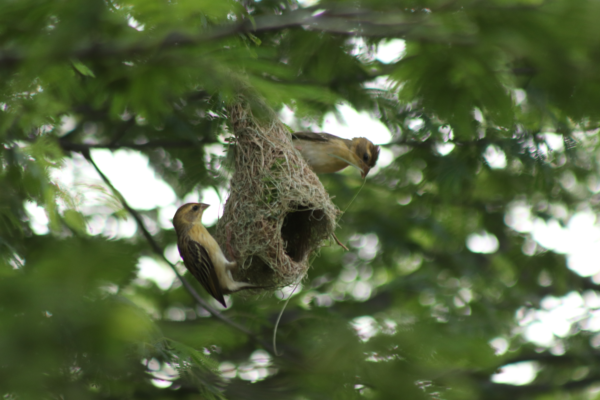

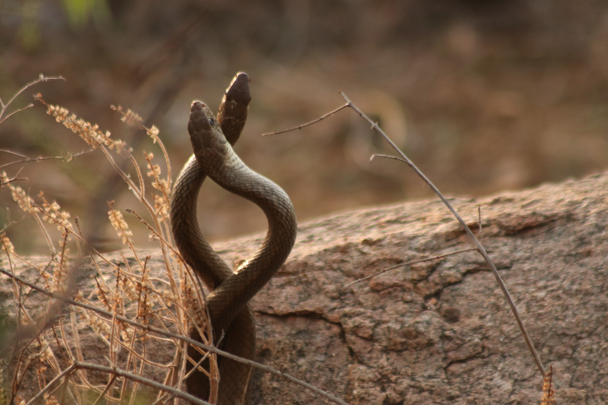

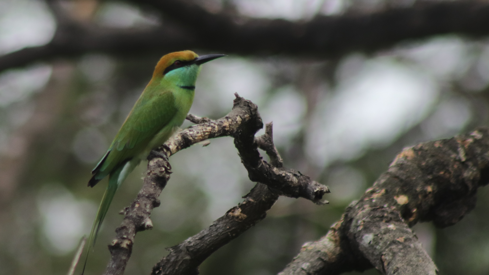

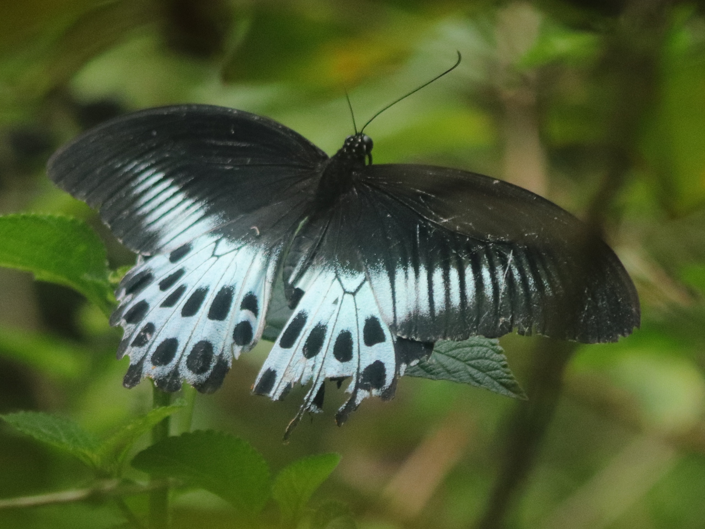

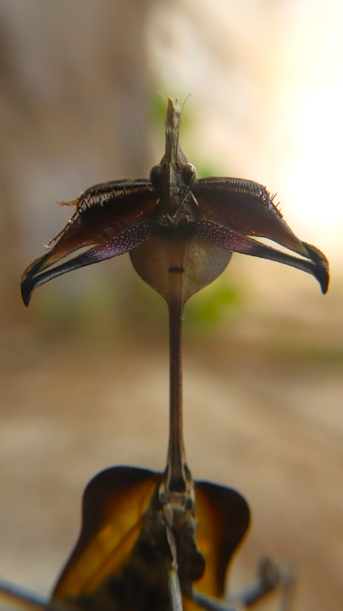

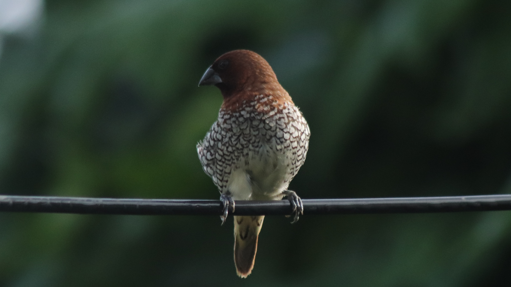

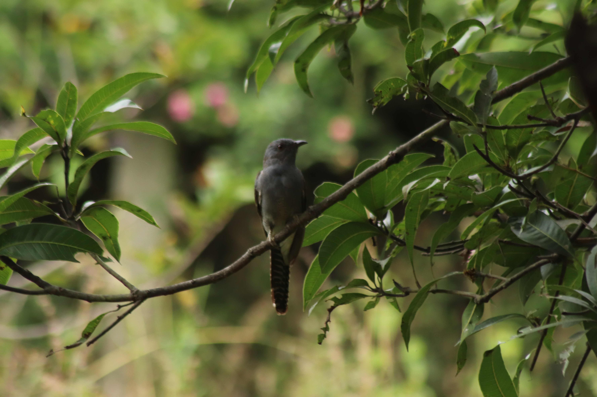

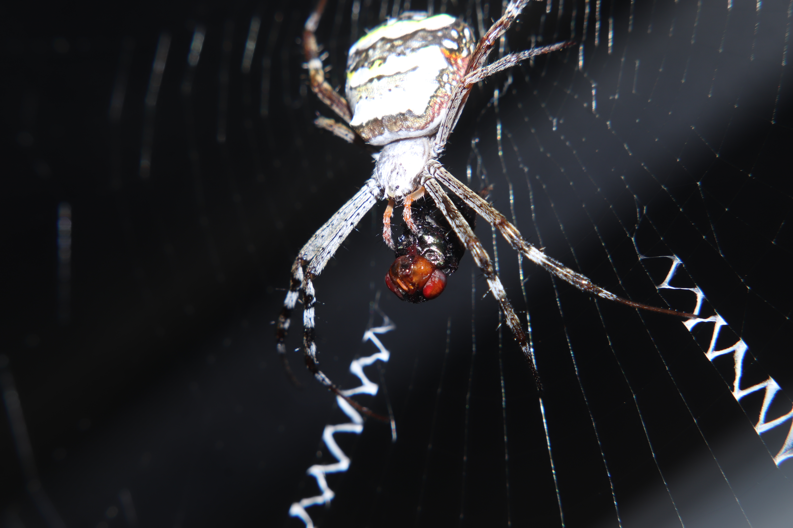

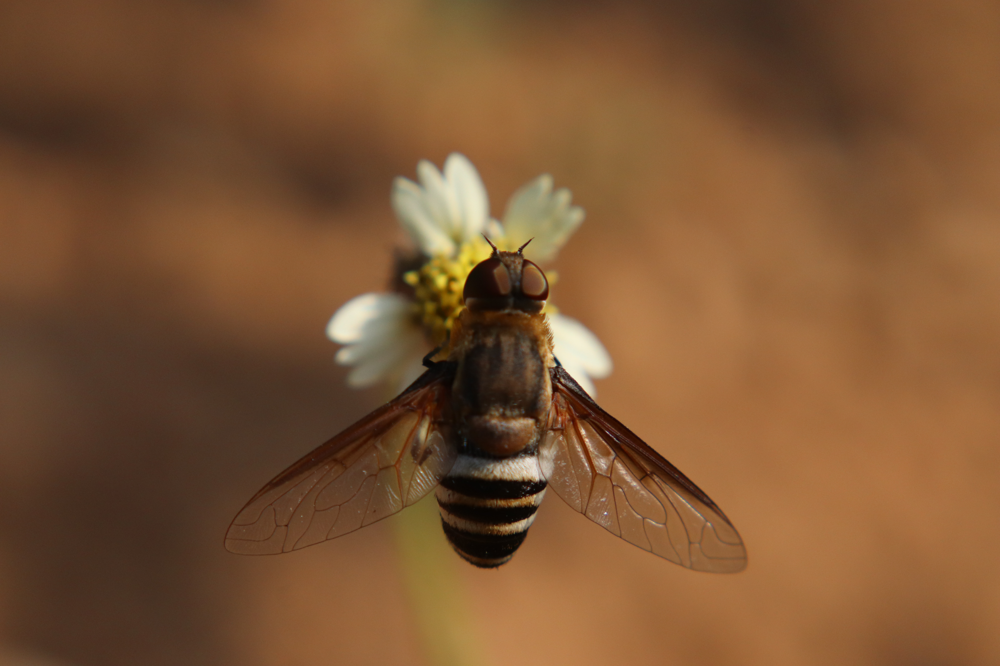

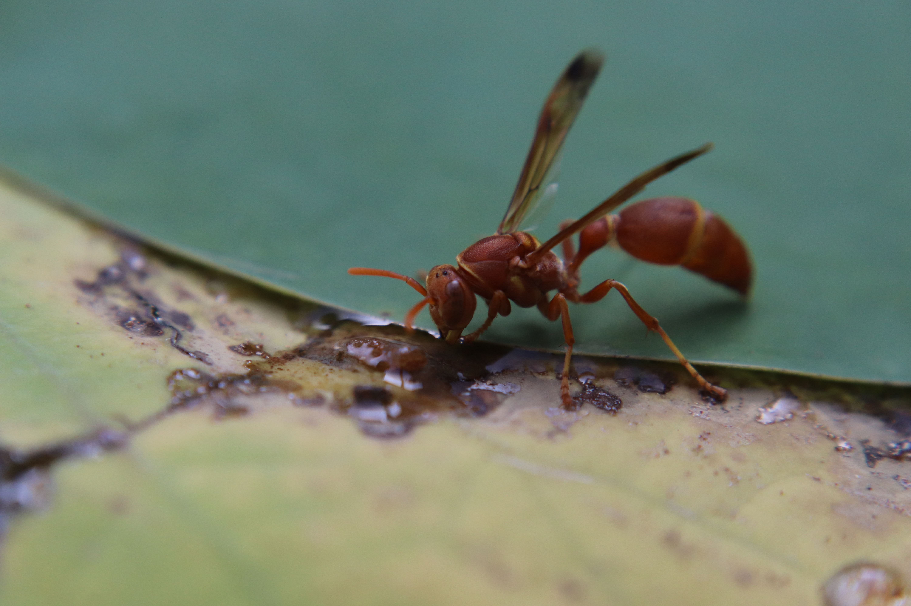

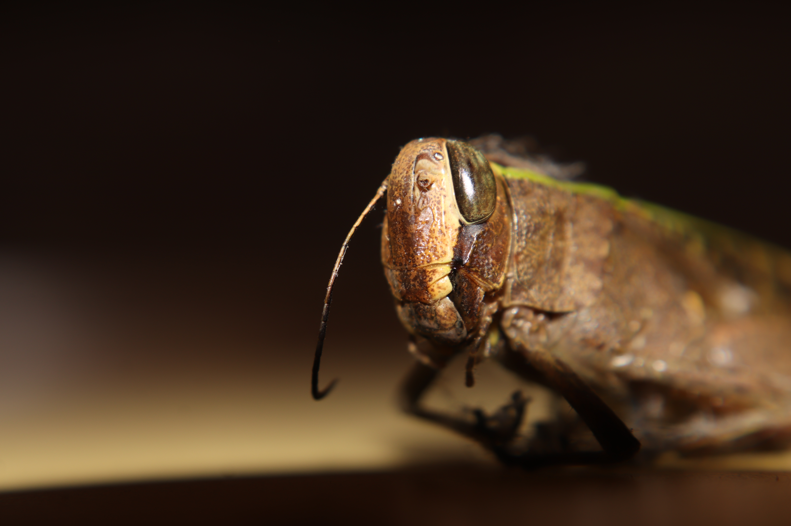

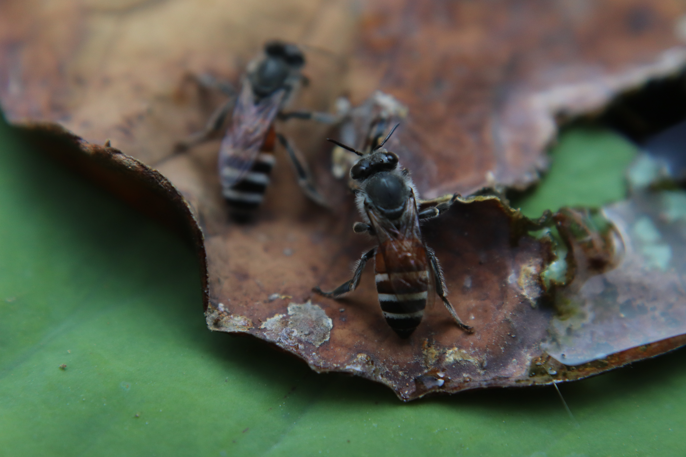

:::

[View the photography collection →](photography-index.qmd)

## Let's Stay Connected

[Instagram ↗](https://instagram.com/ambitious._.juvenile) ·
[iNaturalist ↗](https://www.inaturalist.org/people/8840360) ·
[About me ↗](about.qmd)

---

<small>© 2026 Abhi's Space · Made with curiosity.</small>