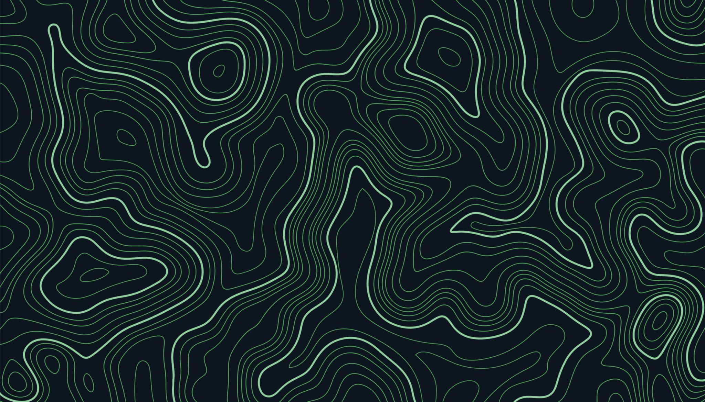

::: {.about-map}

{.map-background}

::: {.map-centre}

YOU ARE HERE

# A little about me.

I'm Abhi. A student, wildlife photographer, naturalist, musician, runner and a few other things that don't fit neatly into a single box.

I spend much of my time learning about the natural world, making things, exploring new interests and figuring out how everything works.

SELECT A DESTINATION TO EXPLORE

:::

<button class="map-marker marker-birds" type="button">
  ✳
  Birdwatching
</button>

<button class="map-marker marker-photo" type="button">
  ✳
  Photography
</button>

<button class="map-marker marker-ecology" type="button">
  ✳
  Ecology
</button>

<button class="map-marker marker-running" type="button">
  ✳
  Running
</button>

<button class="map-marker marker-music" type="button">
  ✳
  Music
</button>

<button class="map-marker marker-about" type="button">
  ✳
  About me
</button>

<button class="map-marker marker-exploring" type="button">
  ✳
  Exploring
</button>

<button class="map-marker marker-writing" type="button">
  ✳
  Writing
</button>

  <button class="panel-close" id="panel-close" type="button">&times;</button>
  A DESTINATION ON THE MAP
  <h3 id="panel-title"></h3>
  

:::

