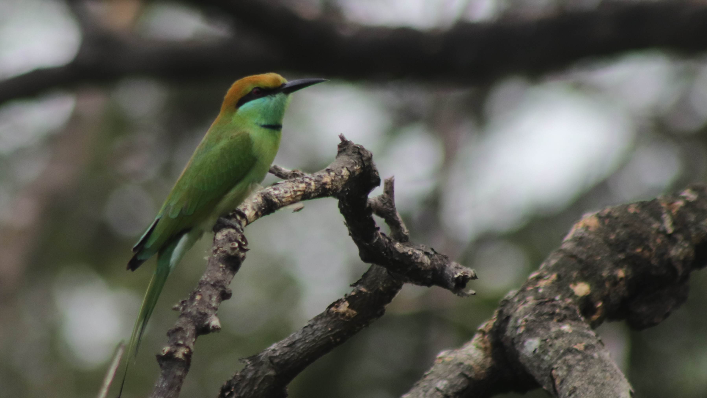

---
title: ""
format:
  html:
    title-block: false
---

<div class="essays-hero">


<div class="essays-hero-overlay"></div>

<div class="essays-hero-content">
<span class="essays-eyebrow">ABHI'S SPACE / JOURNAL</span>
<h1>Essays &amp;<br>Field Notes</h1>
<p>Stories, observations and perspectives on the natural world.</p>
<a href="#writing" class="essays-explore">EXPLORE WRITING <span>↗</span></a>
</div>

</div>

<section id="writing" class="journal-intro">

<div class="journal-intro-inner">

<div class="journal-intro-label">THE JOURNAL</div>

<h2>Observations from<br>the natural world.</h2>

<p class="journal-intro-description">
My collection of stories, observations and reflections on nature,
wildlife, conservation and our relationship with the world.
From the details of the forest floor to the larger questions shaping our planet, these are notes from my time spent exploring.
</p>

<div class="journal-intro-bottom">
<span>ESSAYS · FIELD NOTES · PERSPECTIVES</span>
</div>

</div>

</section>

<section class="featured-story">

<div class="featured-story-inner">

<div class="featured-story-content">

<span class="featured-story-label">FEATURED</span>

<span class="featured-story-category">BIRDS · HOW-TO · WRITING </span>

<h2>BIRDSTALKING BASICS</h2>

<p>
How to stalk, harass and annoy birds the "right" way. (taught by an expert bird stalker)
</p>

<div class="essay-card-wrapper">
<a href="Birdstalking Basics.html" class="essay-card" data-category="Writing">
READ THE ESSAY ↗
</a>
</div>

</div>

<div class="featured-story-image">

</div>

</div>

</section>

```{=html}

<section class="essay-archive">
  <div class="essay-archive-header">
    <div>
      <span class="archive-label">THE COLLECTION</span>
      <h2>More to explore.</h2>
    </div>
    <p>Essays, observations and field notes from the natural world.</p>
  </div>
<div class="essay-filters">
  <button class="essay-filter active" data-filter="all">ALL</button>
  <button class="essay-filter" data-filter="ecology">ECOLOGY</button>
  <button class="essay-filter" data-filter="wildlife">WILDLIFE</button>
  <button class="essay-filter" data-filter="conservation">CONSERVATION</button>
  <button class="essay-filter" data-filter="landscapes">LANDSCAPES</button>
  <button class="essay-filter" data-filter="field-notes">FIELD NOTES</button>
  <button class="essay-filter" data-filter="reflections">REFLECTIONS</button>
</div>


<a href="Birdstalking Basics.html" class="essay-card" data-category="Writing">      <div class="essay-card-image">
        
      </div>
      <div class="essay-card-meta">
        <span>Birdwatching</span>
        <span>28 NOV 2026</span>
      </div>
      <h3>Birdstalking Basics</h3>
      <p>Explaining how to efficiently stalk birds.</p>
      <span class="essay-card-link">READ ESSAY ↗</span>
    </a>
  </div>
</section>
```


<script>
document.addEventListener("DOMContentLoaded", function () {
  const filters = document.querySelectorAll(".essay-filter");
  const cards = document.querySelectorAll(".essay-card");

  filters.forEach(function (button) {
    button.addEventListener("click", function () {
      const selected = button.dataset.filter;

      // Update active button
      filters.forEach(function (filter) {
        filter.classList.remove("active");
      });

      button.classList.add("active");

      // Filter essay cards
      cards.forEach(function (card) {
        const category = card.dataset.category;

        if (selected === "all" || category === selected) {
          card.classList.remove("is-hidden");
        } else {
          card.classList.add("is-hidden");
        }
      });
    });
  });
});
</script>
