---
title: ""
format:
  html:
    title-block: false
---

::: {.hero-container}

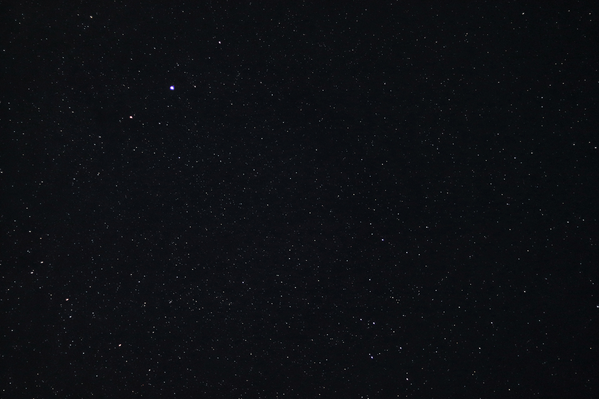{.hero-image}

::: {.hero-text}

# Welcome to Abhi's Space

Exploring the natural world, one story at a time.

:::

:::

## Hi, I'm Abhi!

I'm a nature photographer, wildlife enthusiast, birdwatcher and writer.

I love photography, ecology, birds, music, and exploring the world around me. This is a space where I document the things I discover, the projects I work on, and the stories I collect along the way.

## Explore What I Do

::: {.explore-grid}

::: {.explore-card .card-photography}

::: {.card-overlay}
### Photography

Through the lens of the natural world.

[Explore →](gallery/photography-index.qmd)
:::
:::

::: {.explore-card .card-ecology}

::: {.card-overlay}
### Ecology & Projects

Fieldwork, conservation and things growing.

[Explore →](projects/index.qmd)
:::
:::

::: {.explore-card .card-writing}

::: {.card-overlay}
### Writing & Essays

Thoughts, stories and observations.

[Explore →](essays/essays.qmd)
:::
:::

::: {.explore-card .card-education}

::: {.card-overlay}
### Nature Education

Learning about the natural world.

[Explore →](education/index.qmd)
:::
:::

:::
## Through the Lens

A collection of moments from the natural world.

::: {.photo-grid}

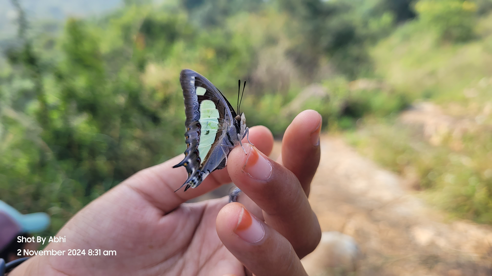

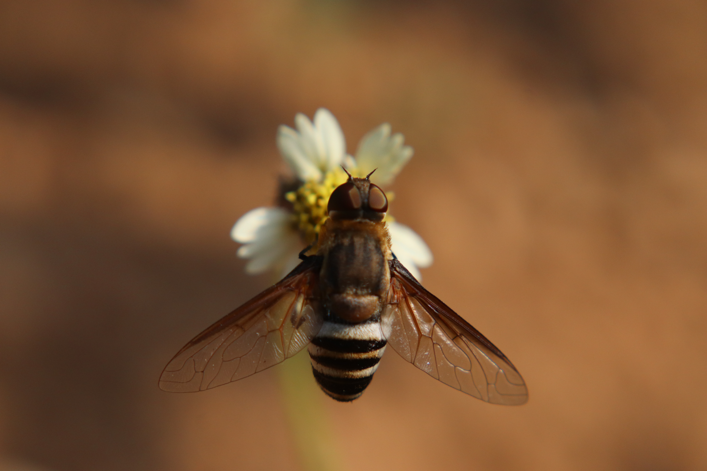

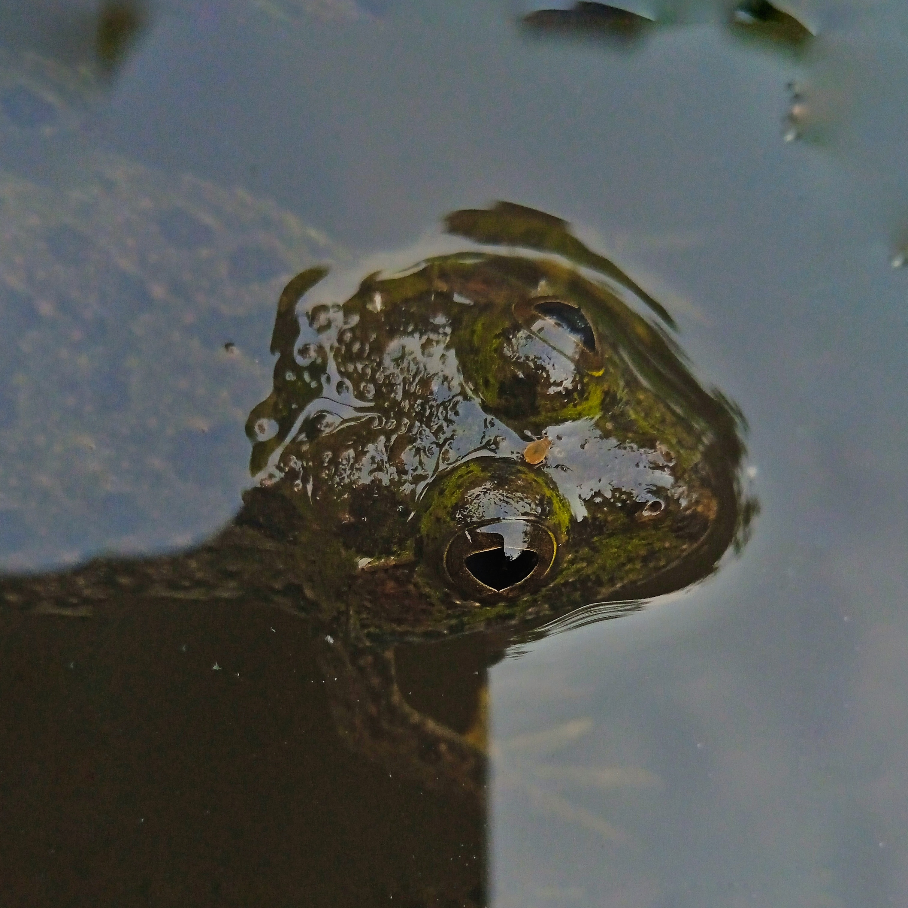

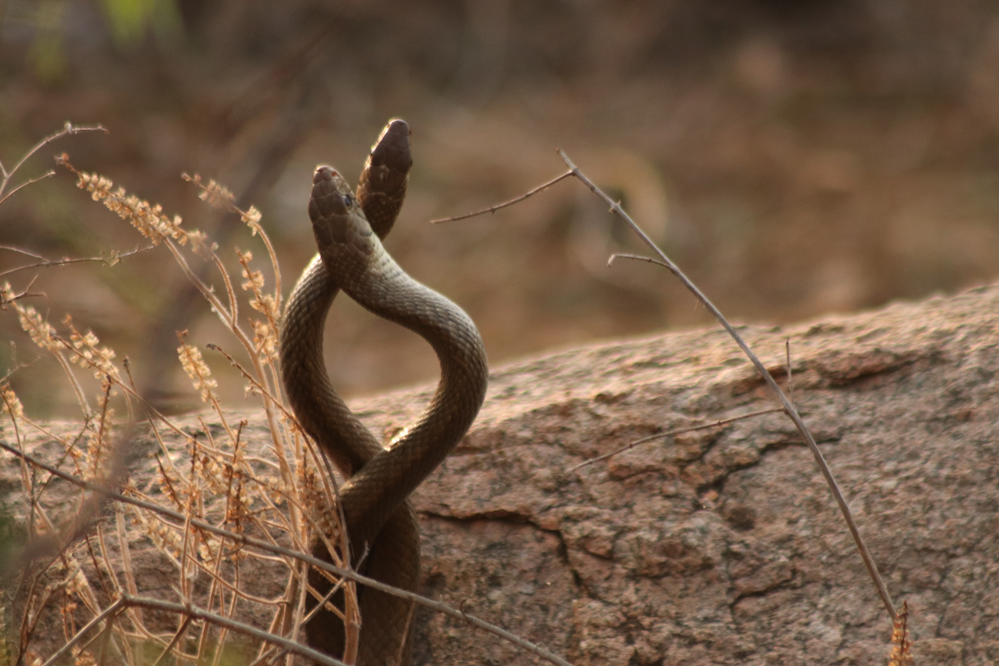

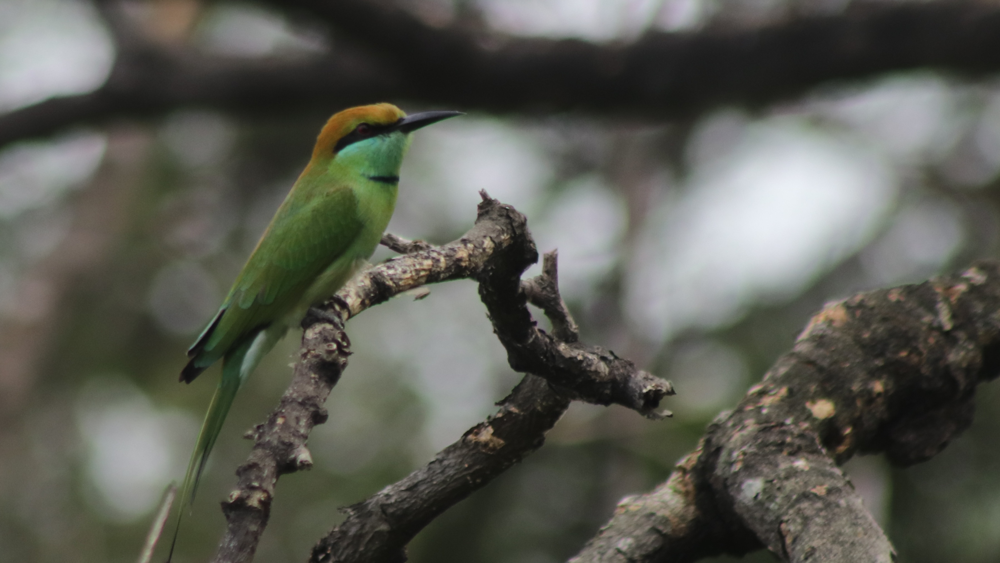

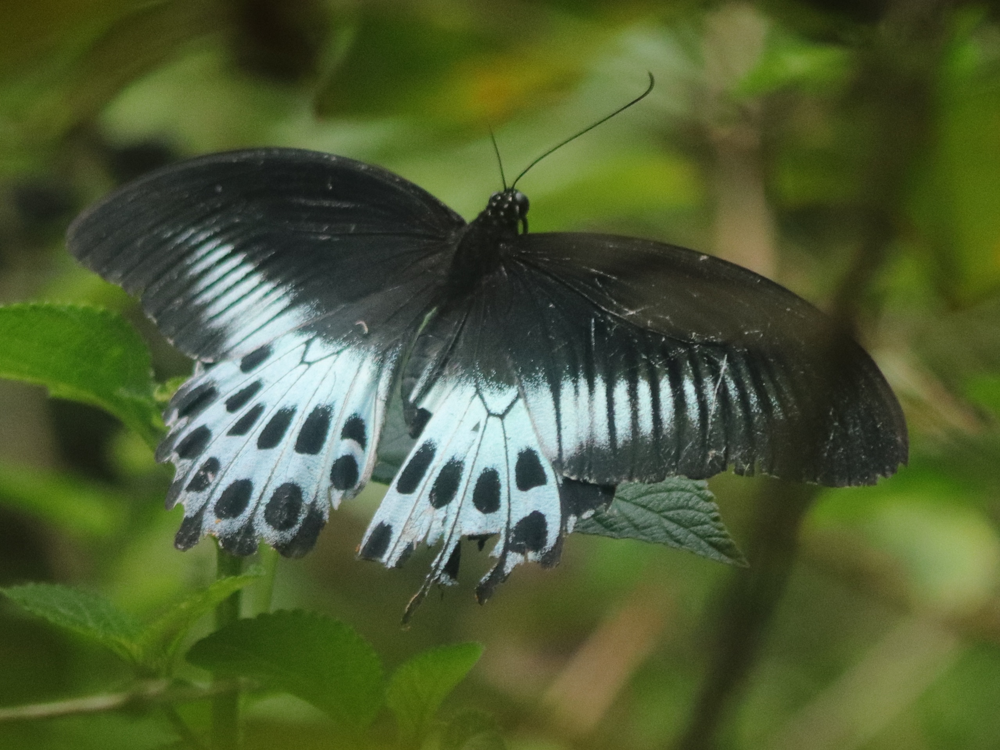

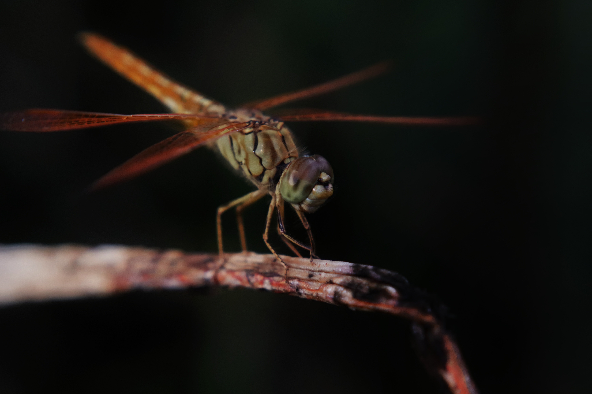

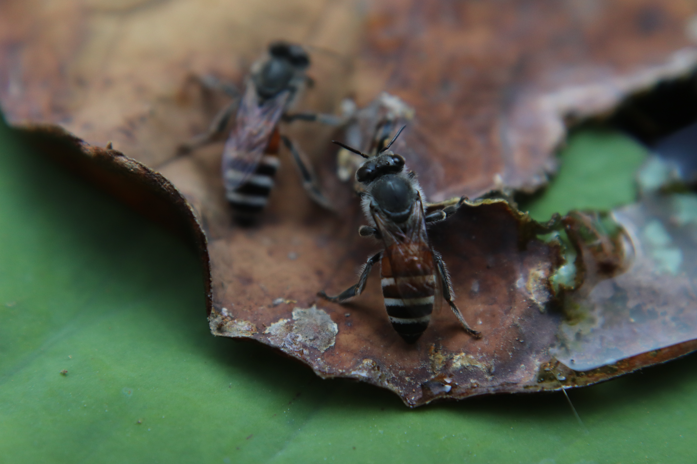

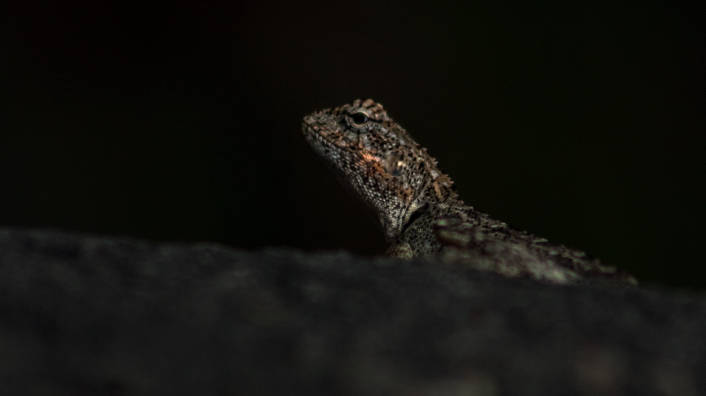

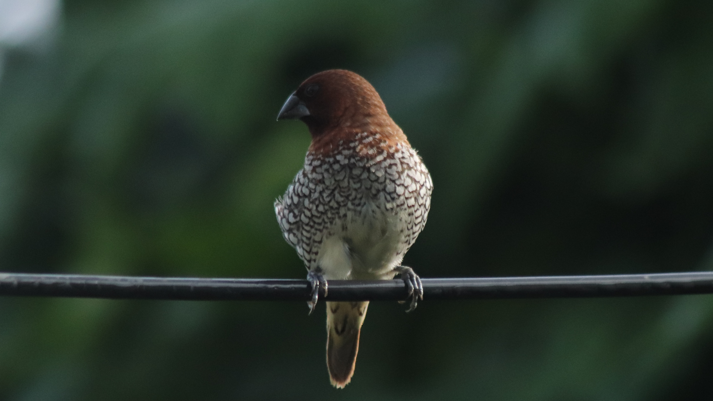

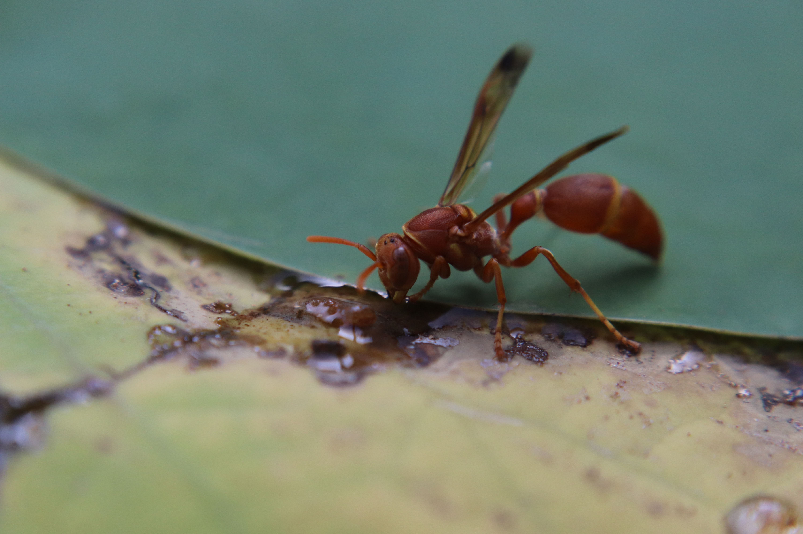

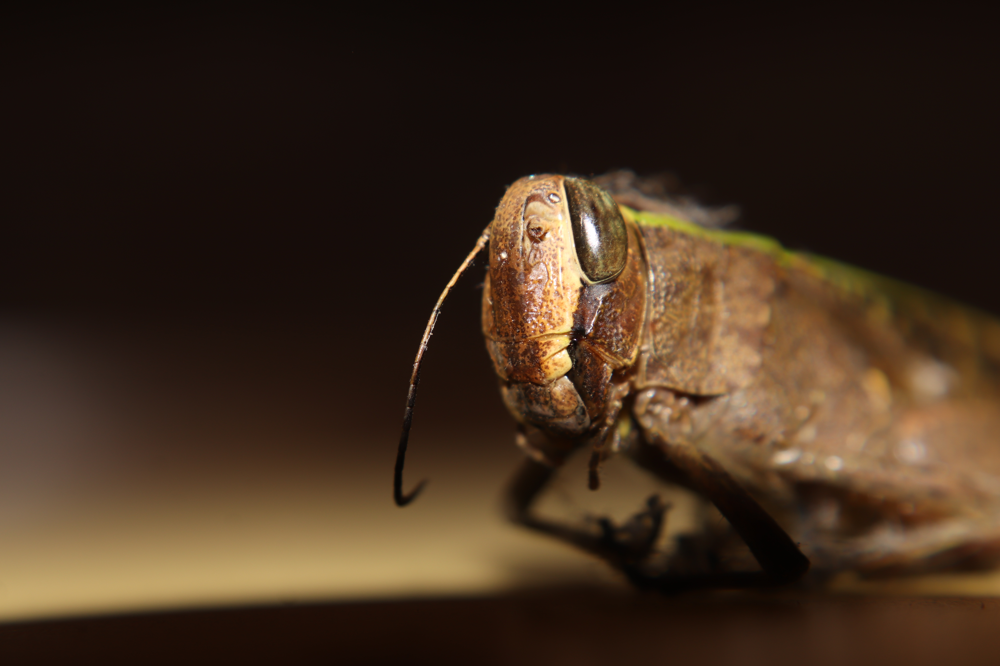

:::

[Explore the photography gallery →](gallery/photography-index.html)

## Let's Connect

You can find more of my work and follow along elsewhere.

[Instagram](https://www.instagram.com/ambitious._.juvenile/)

[iNaturalist](https://www.inaturalist.org/people/8840360)

[About Me](about.qmd)

---

© 2026 Abhi's Space. Built with curiosity.
