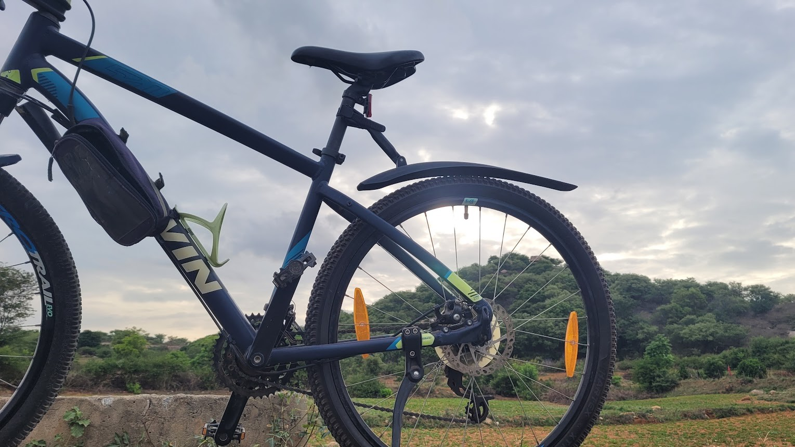

---
title: ""
format:
  html:
    title-block: false
---

```{=html}
<section class="essays-hero projects-hero">
    
  

  <div class="essays-hero-overlay"></div>

  <div class="essays-hero-content">
    <span class="essays-eyebrow">ABHI'S SPACE / FIELDWORK</span>

    <h1>Projects</h1>

    <p>Independent explorations in ecology, natural history and conservation.</p>

    <a href="#projects" class="essays-explore">
      EXPLORE PROJECTS <span>↗</span>
    </a>
  </div>

</section>


<section id="projects" class="journal-intro">

  <div class="journal-intro-inner">

    <div class="journal-intro-label">THE COLLECTION</div>

    <h2>Ideas put into<br>the field.</h2>

    <p class="journal-intro-description">
      A collection of independent projects, field investigations and
      experiments exploring the natural world. Each project is an
      opportunity to observe, investigate and understand the ecosystems
      around us.
    </p>

    <div class="journal-intro-bottom">
      <span>ECOLOGY · FIELD RESEARCH · CONSERVATION</span>
      <span>01 / PROJECTS</span>
    </div>

  </div>

</section>


<section class="essay-archive">

  <div class="essay-archive-header">

    <div>
      <span class="archive-label">CURRENT PROJECTS</span>
      <h2>Work in progress.</h2>
    </div>

    <p>Independent investigations and ongoing explorations.</p>

  </div>

  <div class="essay-card-grid">

    <a href="farmhill-bioacoustics.html" class="essay-card">

      <div class="essay-card-image">
        
      </div>

      <div class="essay-card-meta">
        <span>ECOLOGY · BIOACOUSTICS</span>
        <span>ONGOING</span>
      </div>

      <h3>Farmhill Bioacoustics Map</h3>

      <p>
        Documenting and mapping Farmhill's acoustic biodiversity
        through systematic field recordings and species identification.
      </p>

      <span class="essay-card-link">EXPLORE PROJECT ↗</span>

    </a>

  </div>

</section>
```
